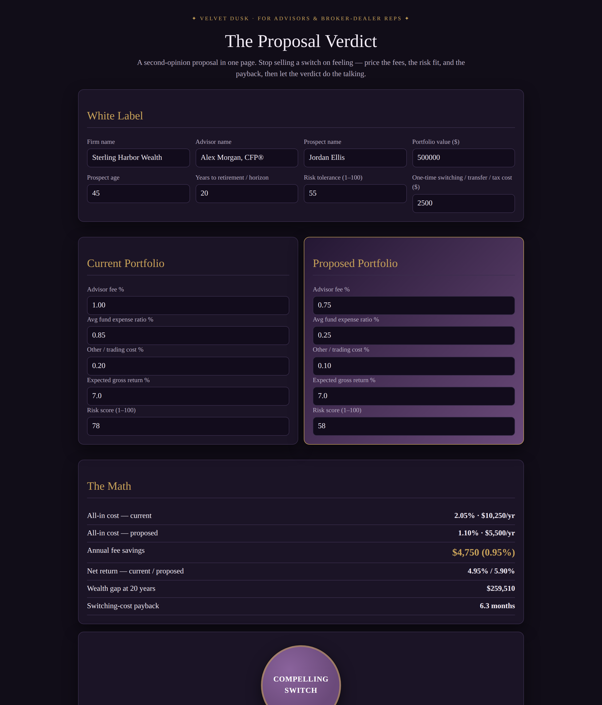

# The Proposal Verdict

**Live:** https://thebullbrew.github.io/proposal-verdict/

A second-opinion proposal builder for RIAs and broker-dealer reps. Enter a prospect's current portfolio and your proposed portfolio — fees, fund expenses, trading costs, expected return, and risk scores — and it prices the switch honestly: all-in cost on both sides, net return, ending wealth at 10 / 20 / 30 years and at the client's own horizon, the wealth gap, annual fee savings, switching-cost payback in months, and risk alignment against the prospect's stated tolerance (within 10 points counts as aligned).

The verdict seal says it plainly: **COMPELLING SWITCH** (annual savings over 0.15% of the portfolio and payback under 24 months), **MARGINAL GAIN**, or **NOT WORTH MOVING** (no savings, or the horizon wealth gap doesn't beat the switching cost). White-label firm and advisor names flow into a printable, copy-ready one-page proposal summary carrying the required hypothetical-illustration disclaimer. Scenarios save in the browser (localStorage). Everything is client-side; nothing leaves the device.

## The method

All-in cost = advisor fee + average fund expense ratio + other/trading costs. Net return = expected gross return − all-in cost. Ending wealth = portfolio × (1 + net return)^years. Payback (months) = one-time switching cost ÷ annual dollar savings. Hypothetical illustration only — not a guarantee, not investment advice; returns are assumed, not promised.

## How to run

Open `docs/index.html` in any browser, or serve the `docs/` folder with any static host. Installable as a PWA; works offline after first load.

Design: Velvet Dusk (Variation 11) — purple-black luxury, velvet-violet highlighted panels, gold for key numbers, italic serif pull-quote verdict.
